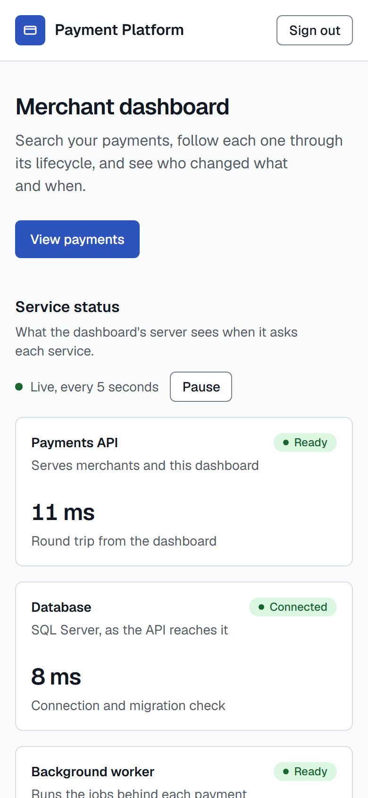
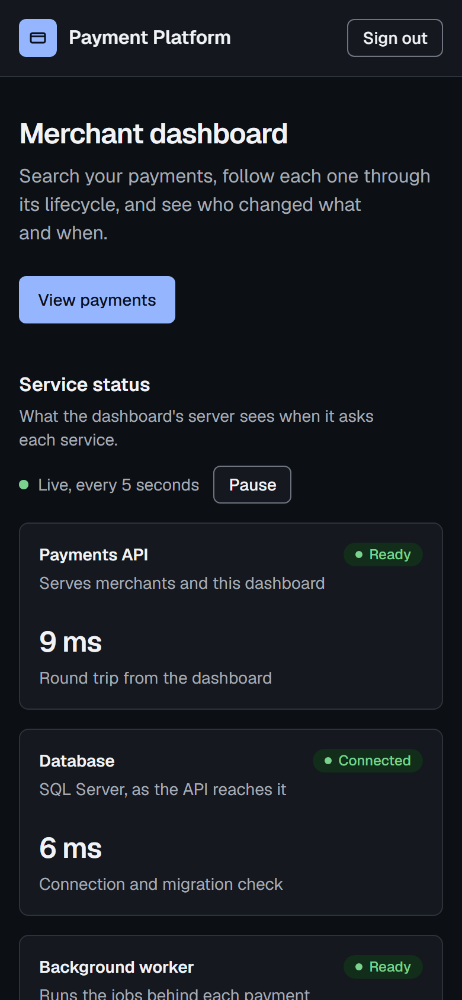

# Payment Platform

[](https://github.com/Antheagao/payment-platform/actions/workflows/ci.yml)
[](https://github.com/Antheagao/payment-platform/actions/workflows/codeql.yml)

A simplified payment processing platform: a C# / .NET 10 API, a background worker, SQL Server, and a Next.js merchant dashboard.

Merchants log in, create payments, capture and refund them, and search their payment history.
Every state change is audited, every money-moving call is idempotent, and a single payment's journey can be traced from the API request through the asynchronous settlement and webhook work.

<picture>
  <source media="(prefers-color-scheme: dark)" srcset="docs/images/dashboard-dark.png">
  
</picture>

## Status

The backend is complete against the exercise's requirements; the dashboard signs merchants in and lists and filters their payments, and a payment's own page is next.
[requirements.md](docs/requirements.md) shows each requirement's status, and [`notes/future.md`](notes/future.md) is the ranked plan.

| Built | Planned next |
| --- | --- |
| The payment lifecycle state machine with every transition tested | A payment's detail page with its audit timeline |
| Create and read payments: the card tokenized at the edge, authorized by the simulated acquirer, every change in the audit trail, and idempotency keys so a retry never charges twice | The service status behind an operator role, and the client's address forwarded to the API |
| Capture and refund, checked against the lifecycle before the card network is called, and saved against the payment's new state if it changed meanwhile | An end-to-end golden path through the composed stack |
| List and search: keyset pages and filters by status, date, amount, currency, and reference, in the API and in the dashboard | A load test |
| A transactional outbox, and signed webhooks (Standard Webhooks) with SSRF rules, retries with backoff, and dead letters | The documentation rewritten against what was built |
| Settlement through a T-SQL stored procedure, every minute in compose | |
| Merchant login with 30-minute HS256 tokens and rate limits; dashboard sign-in with the token in an `HttpOnly` cookie and a nonce-based Content-Security-Policy | |
| JSON logs, OpenTelemetry traces from the request through the worker to the webhook, payment and queue metrics, correlation ids, health and readiness probes | |
| RFC 9457 problem details for every error | |
| 547 backend tests, 121 frontend unit tests, 49 browser runs, CI, CodeQL, containers, Bicep | |
| One command to run it all, tested in CI on every push, a [demo guide](docs/demo.md), and a demo merchant with 280 sample payments in every status | |

## Run it

One command, with nothing to set up first: no `.env`, no SDKs, no accounts.
You need Git and Docker ([Prerequisites](#prerequisites) has the downloads).

```sh
git clone https://github.com/Antheagao/payment-platform.git
cd payment-platform
docker compose up --build
```

The first run downloads the images and packages and builds the three services: about a minute and a half on a CI runner, a few minutes on a home connection.
Later runs start in under a minute.
To run it in the background instead, use `docker compose up --build -d --wait`, then `sh scripts/check-stack.sh`, which waits until every service answers and prints where to open each one.

| Open | For |
| --- | --- |
| <http://localhost:3080> | The merchant dashboard |
| <http://localhost:5080/openapi/v1.json> | The API's OpenAPI document |
| <http://localhost:5080/health/ready> and <http://localhost:5081/health/ready> | API and worker readiness |
| <http://localhost:18888> | The Aspire dashboard: traces, metrics, and structured logs from every service |
| <http://localhost:8090/events> | The webhook receiver standing in for the demo merchant's server: the signed events it verified |

For a guided tour of what to show and what each step proves, follow the [demo guide](docs/demo.md).

`docker compose down` stops everything and keeps the database; `docker compose down -v` deletes it too.
Every port binds to 127.0.0.1, and each can move: if one is taken, copy `.env.example` to `.env` and set its variable, such as `DASHBOARD_PORT=3090`.
SQL Server's image is built for x64 and runs under emulation on Apple silicon.

### If something goes wrong

| What you see | What to do |
| --- | --- |
| `port is already allocated` (another container) or `ports are not available` (another program) | Something else uses that port: set the matching variable in `.env` (`DASHBOARD_PORT`, `API_PORT`, `WORKER_PORT`, `SQL_PORT`, `ASPIRE_DASHBOARD_PORT`, `OTLP_PORT`) |
| `Cannot connect to the Docker daemon`, or on Windows `open //./pipe/dockerDesktopLinuxEngine` | Docker is not running: start Docker Desktop (or the Docker service) and run the command again |
| `sqlserver` restarts or never turns healthy | Give Docker at least 4 GB of memory; on Apple silicon, turn on "Use Rosetta for x86_64/amd64 emulation" in Docker Desktop's settings |
| The dashboard badge says "API not ready" and the Database tile "Unavailable" | The API runs but its database does not answer yet: `docker compose ps -a`, then `docker compose logs sqlserver` |
| The dashboard badge says "API unreachable" | The API is not running: `docker compose logs api` |
| The Background worker tile says "Unreachable" | The worker is not running: `docker compose logs worker` |
| `Login failed for user 'sa'` after changing `MSSQL_SA_PASSWORD` | That password is set only when the database volume is created: `docker compose down -v`, then start again |

## A look around

Every image here is a real capture of the composed stack, made by `node scripts/capture-screenshots.mjs`.

Stopping SQL Server and starting it again: the dashboard follows on its own every 5 seconds and says which piece is down.
The API stays up but reports not ready, so a load balancer would stop sending it traffic, and nothing restarts.


The same page on a phone, in both color schemes; the design tokens follow the operating system, and a script holds every color pair to its contrast target.

| Light | Dark |
| --- | --- |
|  |  |

A payment followed into the Aspire dashboard: one trace runs from the API request (its saves and the `acquirer authorize` call) into the worker, which dispatched the payment's `payment.authorized` event from the transactional outbox and delivered it, signed, to the stack's webhook receiver, all under the correlation id the client sent (`demo-outbox`).


The outage above in the structured logs, each failed check linked to its trace, and the API's request durations as a chart.

| Structured logs | Metrics |
| --- | --- |
|  |  |

## Prerequisites

To run it, only Git and Docker:

| Download | Version | Windows | macOS | Linux |
| --- | --- | --- | --- | --- |
| [Git](https://git-scm.com/downloads) | Any recent | `winget install --id Git.Git -e` | `brew install git` | Your package manager |
| [Docker](https://docs.docker.com/get-started/get-docker/) with Compose v2 | Docker Desktop 4, or Docker Engine 24 or later with the compose plugin | `winget install --id Docker.DockerDesktop -e` | `brew install --cask docker-desktop` | [Docker Engine](https://docs.docker.com/engine/install/) |

Give Docker at least 4 GB of memory (SQL Server needs 2 GB) and leave about 5 GB of disk for the images and the build.
Everything else, from the SQL Server and Aspire images to every NuGet and npm package, is downloaded by `docker compose`.

To work on the code, also:

| Download | Version | Windows | macOS | Linux |
| --- | --- | --- | --- | --- |
| [.NET SDK](https://dotnet.microsoft.com/download/dotnet/10.0) | 10.0.100 or later in the 10.0 line (`backend/global.json`) | `winget install --id Microsoft.DotNet.SDK.10 -e` | `brew install --cask dotnet-sdk` | [Install .NET on Linux](https://learn.microsoft.com/dotnet/core/install/linux) |
| [Node.js](https://nodejs.org/en/download) | 22, as CI and the image use (22 or later works) | `winget install --id OpenJS.NodeJS.22 -e` | `brew install node@22` | [Node.js downloads](https://nodejs.org/en/download) |
| Playwright's Chromium | For `npm run e2e` | `npx playwright install chromium`, from `frontend/` | The same | `npx playwright install --with-deps chromium` |
| [Bicep CLI](https://learn.microsoft.com/azure/azure-resource-manager/bicep/install) | Optional, to validate `infra/` | `winget install --id Microsoft.Bicep -e` | `brew install azure/bicep/bicep` | The release binary |
| [FFmpeg](https://ffmpeg.org/download.html) | Optional, to remake the outage GIF | `winget install --id Gyan.FFmpeg -e` | `brew install ffmpeg` | Your package manager |

`dotnet restore` and `npm ci` fetch the packages; the integration tests start their own SQL Server through Docker.

## Free to run

Nothing here needs a paid service, an account, or a cloud subscription.

| Piece | Cost |
| --- | --- |
| SQL Server 2025, Developer edition (`MSSQL_PID=Developer`) | Free; licensed for development and test, not production |
| Aspire dashboard (traces, metrics, logs) | Free and open source |
| .NET 10, Node.js, Next.js, and every NuGet and npm package | Free; all open source (MIT, Apache 2.0, and similar), except two native helpers SqlClient brings in under free Microsoft license terms |
| The card acquirer | Simulated inside the API: no payment-provider account and no real card numbers |
| The merchant's webhook server | A Node.js receiver in compose (`scripts/webhook-receiver.mjs`); webhooks never leave the machine unless a merchant URL is set |
| Docker | Docker Engine (Linux, and what CI runs) is free and open source; Docker Desktop is free for personal use, education, non-commercial open source, and businesses with fewer than 250 employees and under $10 million in revenue ([license](https://docs.docker.com/subscription/desktop-license/)), and larger organizations need a paid subscription for it |
| CI: GitHub Actions, CodeQL, Dependabot | Free for public repositories |
| Azure | Not needed: the Bicep is validated offline and never deployed |

Any runtime that provides `docker compose` v2 should work; Docker Desktop and Docker Engine are the ones tested.

## Develop

You need the .NET 10 SDK, Node 22, and Docker ([Prerequisites](#prerequisites)).

```sh
# Infrastructure only: SQL Server, the database bootstrap, the Aspire dashboard
docker compose up -d sqlserver sqlserver-init aspire-dashboard

# Backend, from backend/ (integration tests start their own SQL Server)
dotnet build -c Release
dotnet test -c Release
dotnet format --verify-no-changes

# Dashboard, from frontend/
npm ci
npm run dev                     # http://localhost:3080
npm run typecheck && npm run lint && npm test && npm run e2e
```

To run the API or worker with `dotnet run`, point `ConnectionStrings__Payments` at the compose database: `Server=localhost,14333;Database=payments;User Id=payments_app;Password=LocalOnly_App_2026!;TrustServerCertificate=True`.
That password is a public, local-only default for a container bound to 127.0.0.1; Azure has no passwords at all ([infra/](infra/README.md)).
The full list of gates is in [AGENTS.md](AGENTS.md); CI runs exactly those.

## How it fits together


The API owns every rule and writes each state change, its audit row, and its outbox message in one transaction; the worker turns outbox messages into webhook deliveries and settles captured payments.
[architecture.md](docs/architecture.md) walks through the components, the lifecycle, the request and async flows, and the observability seams.

## Repository

| Path | What it holds |
| --- | --- |
| `backend/` | The .NET solution: `src/` (Domain, Persistence, Application, ServiceDefaults, Api, Worker) and `tests/` |
| `frontend/` | The Next.js dashboard |
| `infra/` | Bicep for the Azure shape, validated in CI and never deployed |
| `docs/` | Architecture, requirements, assumptions, tradeoffs, production considerations, decision records |
| `notes/` | The rotating past, present, and future notes the work is planned from |
| `scripts/` | The documentation and contrast checks, the stack check, the screenshot capture, and the local database bootstrap |
| `.claude/` | Agent configuration and the engineering guides the code follows |

## Documentation

- [Demo guide](docs/demo.md): a twenty-minute walkthrough of the running stack, step by step.
- [Requirements traceability](docs/requirements.md): every requirement, where it lives, and its status.
- [Architecture](docs/architecture.md): components, flows, observability, security, scaling, and the Azure mapping.
- [Assumptions](docs/assumptions.md): what we decided where the brief was open.
- [Tradeoffs](docs/tradeoffs.md): what we chose and what we gave up.
- [Production considerations](docs/production.md): what changes before real money.
- [Future improvements](docs/future-improvements.md): what we would build with more time.
- [Decision records](docs/decisions/README.md): the choices that are hard to reverse.
- [Infrastructure](infra/README.md): the Azure resources and what a deployment would add.

## How it is built

The work runs as a queue of small tasks in [`notes/future.md`](notes/future.md); each task is one or two commits that carry the code, its tests, and the rotated notes, and is pushed when its gates pass.
`.githooks/` refuses a commit that changes code without updating [`notes/present.md`](notes/present.md), so the notes and the code never drift; enable it with `git config core.hooksPath .githooks`.
The engineering rules come from a shared set of guides, with a `payment-platform-*` overlay per topic in `.claude/skills/` that records what is specific to this repository.
