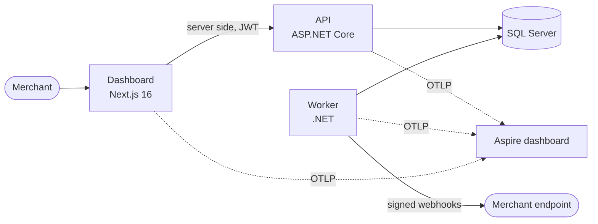

# Payment Platform

[](https://github.com/Antheagao/payment-platform/actions/workflows/ci.yml)
[](https://github.com/Antheagao/payment-platform/actions/workflows/codeql.yml)

A simplified payment processing platform: a C# / .NET 10 API, a background worker, SQL Server, and a Next.js merchant dashboard.

Merchants log in, create payments, capture and refund them, and search their payment history.
Every state change is audited, every money-moving call is idempotent, and a single payment's journey can be traced from the API request through the asynchronous settlement and webhook work.

## Status

The foundation is complete: every component exists, runs, is observable, and is covered by the gates CI runs.
The payment features are next, in the order the exercise weighs them; [requirements.md](docs/requirements.md) shows each requirement's status, and [`notes/future.md`](notes/future.md) is the ranked plan.

| Built | Planned next |
| --- | --- |
| The payment lifecycle state machine with every transition tested | Merchant login with short-lived JWTs |
| JSON logs, OpenTelemetry traces and metrics, correlation ids, health and readiness probes | Create, read, capture, refund, and search payments, with idempotency keys and an audit trail |
| RFC 9457 problem details for every error | The transactional outbox, signed webhooks with retries and dead-lettering, settlement |
| The worker's job runner, the simulated acquirer | Domain and queue metrics |
| The dashboard shell with accessible design tokens | Sign-in, the payments list, and the payment timeline |
| 169 backend tests, 16 frontend unit tests, 12 browser runs, CI, CodeQL, containers, Bicep | End-to-end golden path, load test |

## Run it

You need Docker. Then:

```sh
git clone https://github.com/Antheagao/payment-platform.git
cd payment-platform
cp .env.example .env
docker compose up --build
```

| Open | For |
| --- | --- |
| <http://localhost:3080> | The merchant dashboard |
| <http://localhost:5080/openapi/v1.json> | The API's OpenAPI document |
| <http://localhost:5080/health/ready> and <http://localhost:5081/health/ready> | API and worker readiness |
| <http://localhost:18888> | The Aspire dashboard: traces, metrics, and structured logs from every service |

`docker compose down` stops everything; the database survives in a named volume.
SQL Server's image is built for x64 and runs under emulation on Apple silicon.

## Develop

You need the .NET 10 SDK, Node 22, and Docker.

```sh
# Infrastructure only: SQL Server, the database bootstrap, the Aspire dashboard
docker compose up -d sqlserver sqlserver-init aspire-dashboard

# Backend, from backend/ (integration tests start their own SQL Server)
dotnet build -c Release
dotnet test -c Release
dotnet format --verify-no-changes

# Dashboard, from frontend/
npm ci
npm run dev                     # http://localhost:3080
npm run typecheck && npm run lint && npm test && npm run e2e
```

To run the API or worker with `dotnet run`, point `ConnectionStrings__Payments` at the compose database: `Server=localhost,14333;Database=payments;User Id=payments_app;TrustServerCertificate=True`, plus `Password=` followed by `PAYMENTS_DB_PASSWORD` from your `.env`.
The full list of gates is in [AGENTS.md](AGENTS.md); CI runs exactly those.

## How it fits together



The API owns every rule and writes each state change, its audit row, and its outbox message in one transaction; the worker turns outbox messages into webhook deliveries and settles captured payments.
[architecture.md](docs/architecture.md) walks through the components, the lifecycle, the request and async flows, and the observability seams.

## Repository

| Path | What it holds |
| --- | --- |
| `backend/` | The .NET solution: `src/` (Domain, Persistence, Application, ServiceDefaults, Api, Worker) and `tests/` |
| `frontend/` | The Next.js dashboard |
| `infra/` | Bicep for the Azure shape, validated in CI and never deployed |
| `docs/` | Architecture, requirements, assumptions, tradeoffs, production considerations, decision records |
| `notes/` | The rotating past, present, and future notes the work is planned from |
| `scripts/` | The documentation and contrast checks, and the local database bootstrap |
| `.claude/` | Agent configuration and the engineering guides the code follows |

## Documentation

- [Requirements traceability](docs/requirements.md): every requirement, where it lives, and its status.
- [Architecture](docs/architecture.md): components, flows, observability, security, scaling, and the Azure mapping.
- [Assumptions](docs/assumptions.md): what we decided where the brief was open.
- [Tradeoffs](docs/tradeoffs.md): what we chose and what we gave up.
- [Production considerations](docs/production.md): what changes before real money.
- [Future improvements](docs/future-improvements.md): what we would build with more time.
- [Decision records](docs/decisions/README.md): the choices that are hard to reverse.
- [Infrastructure](infra/README.md): the Azure resources and what a deployment would add.

## How it is built

The work runs as a queue of small tasks in [`notes/future.md`](notes/future.md); each task is one or two commits that carry the code, its tests, and the rotated notes, and is pushed when its gates pass.
`.githooks/` refuses a commit that changes code without updating [`notes/present.md`](notes/present.md), so the notes and the code never drift; enable it with `git config core.hooksPath .githooks`.
The engineering rules come from a shared set of guides, with a `payment-platform-*` overlay per topic in `.claude/skills/` that records what is specific to this repository.
