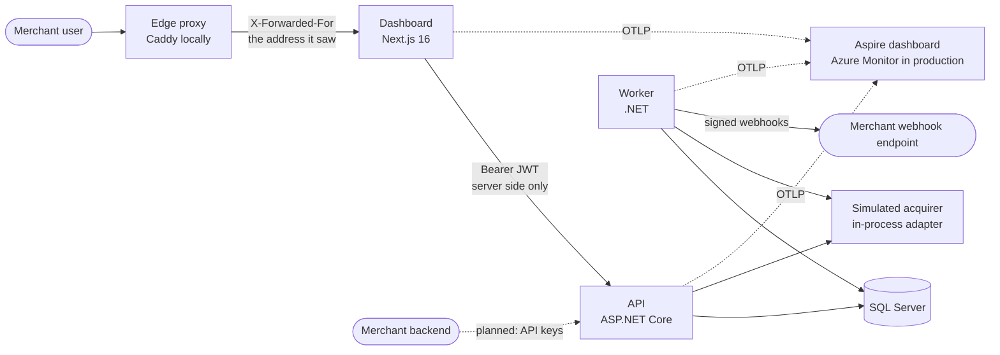
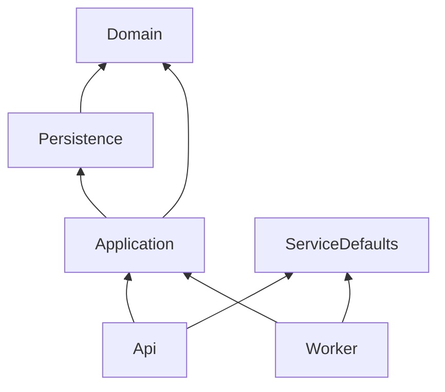
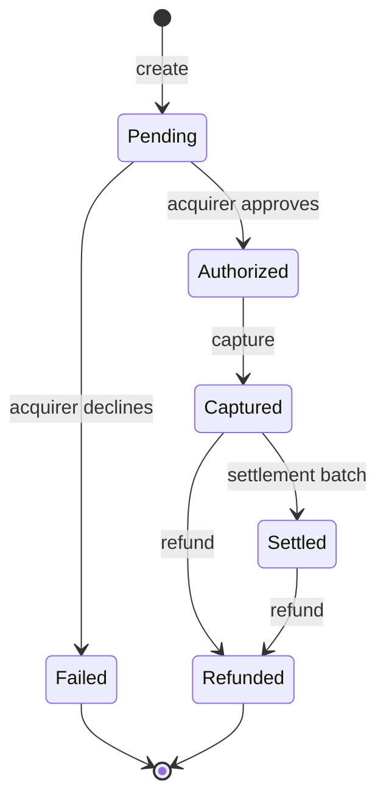
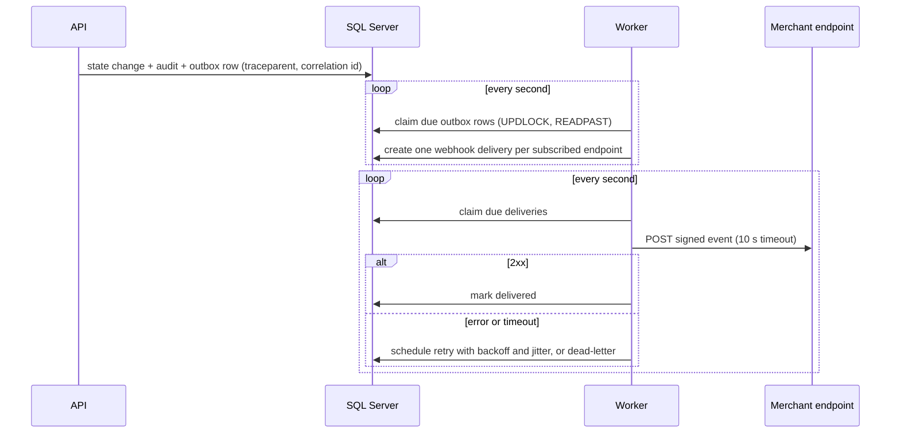

# Architecture

How the platform is put together, how a payment moves through it, and where the operational seams are.
Decisions that were hard to make or would be hard to reverse are recorded in [decisions/](decisions/README.md); this page describes the result.
Parts marked *planned* are designed and queued in `notes/future.md` but not built yet.

## Components



| Component | Responsibility |
| --- | --- |
| **Edge proxy** (`infra/edge/Caddyfile`) | The only way to the dashboard: it writes the address each browser connected from into `X-Forwarded-For`, replacing any the browser sent. Caddy in compose; App Service's front end in Azure ([ADR 010](decisions/010-client-address-from-the-dashboard.md)). |
| **Dashboard** (`frontend/`) | Merchant-facing UI: log in, list and search payments, view a payment and its history. Holds the login token in an HttpOnly cookie on its own server and calls the API from server code only; its server also asks the worker's readiness probe for the home page's service status. |
| **API** (`backend/src/PaymentPlatform.Api`) | Authenticates merchants, owns every business rule, and writes each state change, its audit entry, and its outbox message in one transaction. |
| **Worker** (`backend/src/PaymentPlatform.Worker`) | Runs the asynchronous work: dispatches outbox messages into webhook deliveries, delivers webhooks with retries, settles captured payments, reconciles payments left `Pending`, measures its queues, and deletes expired idempotency keys. |
| **SQL Server** | The single source of truth: payments, the audit trail, idempotency records, the outbox, and webhook deliveries. |
| **Simulated acquirer** | A deterministic stand-in for the card network behind a port, so the real integration is one adapter away. |
| **Observability backend** | Locally the Aspire dashboard receives traces, metrics, and logs over OTLP; in production the same signals go to Application Insights. |

## Backend projects



- **Domain** is pure C#: the payment aggregate, the lifecycle transition table, money, and domain events.
  It references nothing outside the base class library, which an architecture test enforces.
- **Persistence** owns the EF Core model, the migrations, and the T-SQL objects such as the settlement stored procedure.
- **Application** holds the use cases in feature folders (`Payments/`, `Settlement/`, `Webhooks/`) and the ports for the external systems: the acquirer and the webhook transport.
  Use cases work with the `DbContext` directly; there is no repository layer over EF Core ([ADR 002](decisions/002-backend-project-boundaries.md)).
- **Api** and **Worker** are thin hosts: they translate HTTP requests or timer ticks into use-case calls.
- **ServiceDefaults** is shared host wiring: JSON logging, OpenTelemetry, health endpoints, and the correlation id.

## The payment lifecycle



The transition table lives in the Domain project and is the only code allowed to change a payment's status.
Every transition produces a domain event; when the change is saved, the event becomes one audit row in `PaymentEvents` (who, when, from, to, the correlation id) and one outbox message, in the same transaction as the status change.

## Creating a payment

```mermaid
sequenceDiagram
    participant C as Client
    participant A as API
    participant D as SQL Server
    participant Q as Acquirer
    C->>A: POST /api/v1/payments (Idempotency-Key)
    A->>D: claim the key; insert Pending payment + audit row
    A->>Q: authorize(token, amount)
    Q-->>A: approved or declined
    A->>D: Authorized or Failed + audit row + outbox message; store the response on the key
    A-->>C: 201 with the payment
```

- The acquirer call happens between two short transactions, never inside one, so a slow acquirer cannot hold locks.
- If the acquirer does not answer, or the process dies after it answers, the payment stays `Pending`, visibly, rather than becoming a charge with no record.
  The worker's reconciliation job (`ReconcilePendingPayments`, every minute) asks the acquirer again by payment id, which is also the acquirer-side idempotency key, once a payment is past a grace period longer than any request; it moves it to `Authorized` or `Failed` as the `system` actor `reconciliation`, asks again after a retry interval while there is still no answer, and fails it as `acquirer_unreachable`, logged at `Error`, after a day.
- A retry with the same `Idempotency-Key` replays the stored response; a retry while the first is still running gets `409`, and the same key with a different body gets `422` ([ADR 007](decisions/007-idempotency-keys.md)).

## The asynchronous workflow



- **Transactional outbox.** The message is written in the same transaction as the change that causes it, so there is never an event without a change or a change without an event ([ADR 003](decisions/003-async-workflow-on-a-transactional-outbox.md)).
- **Competing consumers.** Rows are claimed with `UPDLOCK, READPAST`, so several worker instances share the load without double-processing; a claim is a lease that expires if the worker dies.
- **Retries.** Exponential backoff with full jitter from 10 seconds to 1 hour, 12 attempts at most (the waits add up to about 3.4 hours at the longest); after the last the delivery is dead-lettered, logged at `Error`, and counted.
- **Throughput.** One worker kept up to about 400 checkouts a second in the [load test](load-test.md) and fell behind at 600; a second one shared the queues and bounded the backlog.
- **Trace continuity.** The outbox row stores the W3C `traceparent` and the correlation id of the request that wrote it; the worker restores both, so the webhook delivery appears in the same trace as the API call and its logs carry the same correlation id.
- **Settlement.** A scheduled job calls a T-SQL stored procedure that moves due `Captured` payments to `Settled` in batches, writing the audit rows and outbox messages set-based in the same transaction.

## Observability

| Signal | What is emitted | Where it goes |
| --- | --- | --- |
| Logs | JSON lines with timestamp, level, category, message template, and scope properties: `CorrelationId`, `TraceId`, `SpanId`, `MerchantId`, `PaymentId` (PascalCase, the .NET logging convention) | Console (collected by the platform) and OTLP |
| Traces | The dashboard's page renders, Server Actions, and calls to the API (`src/instrumentation.ts`); ASP.NET Core, HttpClient, and SQL client spans, plus custom spans for the acquirer call, each outbox dispatch, and each webhook delivery, all in one trace from the dashboard's server to the merchant's endpoint | OTLP |
| Metrics | RED metrics from the ASP.NET Core and HttpClient meters (health probes excluded); `PaymentPlatform.Payments` (`payments.transitions`, by the status left and entered, counted once a save commits); `PaymentPlatform.Outbox` (`webhook.delivery.attempts` by outcome, and gauges for outbox depth and oldest age, deliveries due and their lag, retries, dead letters, the settlement backlog, and the payments due for reconciliation, measured every 10 s by the worker); `PaymentPlatform.Worker` (job durations and failures) | OTLP |
| Health | `/health/live` (the process answers) and `/health/ready` (the database answers and the schema is current) on the API and the worker | Load balancer and orchestrator probes |
| Audit | One `PaymentEvents` row per transition: actor, time, from, to, correlation id | SQL Server, shown on the dashboard's payment page |

Card numbers, CVVs, tokens, passwords, and secrets never reach a log line: request bodies are not logged, the card number is tokenized before anything else touches it, and a test captures the logs of a full payment flow and asserts none of them appear ([ADR 005](decisions/005-observability-on-opentelemetry.md)).

## Security

- **Authentication.** `POST /api/v1/auth/login` checks the password and issues a JWT signed with HMAC-SHA256, valid for 30 minutes, carrying the user id and merchant id.
  The API validates the signature, issuer, audience, and lifetime on every request ([ADR 004](decisions/004-authentication-with-short-lived-jwts.md)).
- **The browser never holds the token.** The dashboard's server keeps it in an HttpOnly, Secure, SameSite=Strict cookie and calls the API from server code, so injected script cannot read it.
- **Authorization.** Every query is scoped to the caller's merchant id; a foreign id is a `404`.
  Platform staff are an identity of their own, signed in at `/api/v1/staff/auth/login`: their token carries `role` `staff` and no merchant id, so the default policy refuses it on every merchant route and the `staff` policy refuses a merchant's token on every staff route ([ADR 011](decisions/011-platform-staff-as-their-own-identity.md)).
  The dead-letter replay is staff work, logged with the staff user's id.
- **Abuse.** Login is rate limited per account and per person's address; the dashboard names the address its edge saw, under a key it shares with the API, and the API believes no other caller's claim ([ADR 010](decisions/010-client-address-from-the-dashboard.md)).
  Request bodies are size-capped and requests time-limited.
- **Secrets.** Local secrets come from `.env` and user secrets; in production they come from Key Vault through managed identity.

## Scaling

- The API is stateless (JWT, no session affinity), so it scales horizontally behind a load balancer.
- The worker scales by adding instances; row claiming with `READPAST` keeps them from colliding, and a second worker halved the webhook backlog in the [load test](load-test.md), where the worker was the first thing to fall behind.
- List queries use keyset pagination over the clustered `(MerchantId, CreatedAt, Sequence)` index, so page cost stays flat as the table grows: 2 ms at the p95 up to 700 requests a second in the load test.
- Beyond one database's write capacity, the outbox relay moves to Azure Service Bus and consumers become Service Bus-triggered functions; search moves to a read replica or a search index fed from the same events.

## Running in Azure (validated, never deployed)

| Local | Azure |
| --- | --- |
| API container | App Service (Linux) with a managed identity |
| Worker container | App Service with Always On today; Azure Functions on Service Bus triggers once the outbox relays to Service Bus |
| Caddy edge container | App Service's front end (Front Door ahead of it, planned) |
| Dashboard container | App Service (Node) |
| SQL Server container | Azure SQL Database with Entra-only authentication |
| Database outbox polling | Outbox relay to Azure Service Bus queues |
| `.env` | Key Vault references |
| Aspire dashboard | Application Insights through the Azure Monitor OpenTelemetry distro |

The Bicep in `infra/` describes this shape and is validated in CI (T17).
