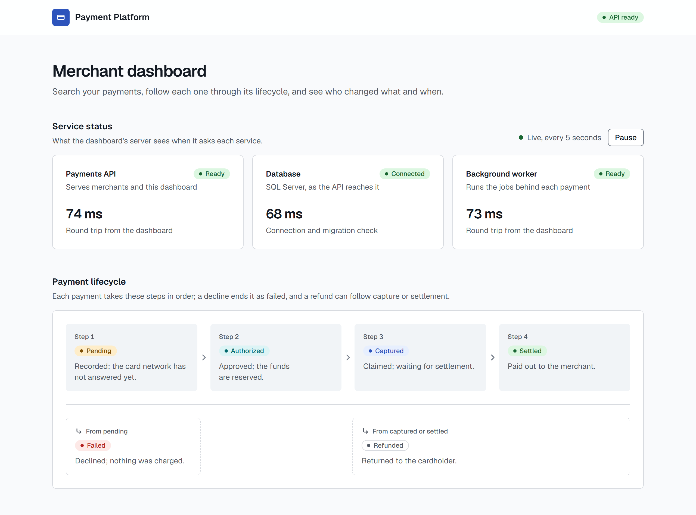

# Demo guide

A ten-minute walkthrough of what runs today, in the order that tells the story.
Each step gives the command, what you will see, and the point it makes.
Everything here was run against the composed stack; the payment features arrive in the order [notes/future.md](../notes/future.md) ranks them, and this guide grows with them.

On Windows, type `curl.exe` instead of `curl` in Windows PowerShell 5.1, where `curl` means `Invoke-WebRequest`; PowerShell 7, Git Bash, macOS, and Linux need no change.

## 1. One command

```sh
docker compose up --build -d --wait
sh scripts/check-stack.sh
```

The check waits for both readiness probes, the OpenAPI document, the dashboard, and the Aspire dashboard, then prints where to open each one.

**The point:** a fresh clone needs Git and Docker and nothing else: no `.env`, no SDK, no account, no paid service.
CI runs exactly these two commands on a clean runner on every push (the `stack` job).

## 2. The merchant dashboard

Open <http://localhost:3080>.



- The badge in the header reads **API ready**.
  The dashboard's server asked the API's readiness probe; the browser never talks to the API and never sees its address or a token ([ADR 004](decisions/004-authentication-with-short-lived-jwts.md)).
- **Service status** has a tile for the payments API, its database as the API reports it, and the background worker, each with its readiness and a measured time: the round trip from the dashboard's server, or the API's own connection and migration check.
  It asks again every 5 seconds while the tab is visible; **Pause** stops it, because content that updates itself must be stoppable (WCAG 2.2.2).
- **Payment lifecycle** draws the four steps (`Pending`, `Authorized`, `Captured`, `Settled`) as a flow, with each terminal branch (`Failed`, `Refunded`) under the step it leaves.
  It mirrors `PaymentLifecycle` in the domain project, where every one of the 36 status pairs is tested.
- Switch the operating system between light and dark, or narrow the window to a phone's width: the design tokens follow, and a script checks their contrast in CI, including that no status pill reads louder than another.

**The point:** the shell is accessible and responsive before any feature lands on it, and it already shows the running system honestly.

## 3. Errors are a contract

```sh
curl -i -H "X-Correlation-Id: demo-1" http://localhost:5080/api/v1/payments/123
```

The answer is `404` with `Content-Type: application/problem+json`, an `X-Correlation-Id: demo-1` header, the security headers (`nosniff`, `DENY`, a `default-src 'none'` policy, `no-referrer`, `no-store`), and a body like:

```json
{
  "type": "https://tools.ietf.org/html/rfc9110#section-15.5.5",
  "title": "Not Found",
  "status": 404,
  "detail": "no resource matches this path",
  "trace_id": "d06d3edee90c34ec64eaab0840c76ce9",
  "code": "not_found",
  "correlation_id": "demo-1"
}
```

Then a method the route does not allow:

```sh
curl -i -X DELETE http://localhost:5080/health/ready
```

That is `405` with `Allow: GET, HEAD`, in the same shape.

**The point:** every error, including the framework's own, is RFC 9457 problem details with a stable `code` a client can switch on, and carries the ids that find it again ([ADR 006](decisions/006-errors-as-problem-details.md)).

## 4. Follow the request in the Aspire dashboard

Open `http://localhost:18888/traces/detail/` followed by the `trace_id` from step 3.
The trace shows the `payment-api` span and how long it took; select it for its attributes, among them `correlation.id`, the status code, and the path.


Then open **Structured logs**: each line is JSON with its trace id and scopes, and the API's startup reports `Database migrated at startup`.
**Metrics** shows `http.server.request.duration`, Kestrel's connections, and the .NET runtime for `payment-api` and `payment-worker`.


The yellow "Endpoint is unsecured" banner is expected: the dashboard runs without a login because it is local only and bound to 127.0.0.1; a shared environment would use its login token.

**The point:** logs, traces, and metrics share one id from the first request, through OpenTelemetry and OTLP ([ADR 005](decisions/005-observability-on-opentelemetry.md)); in Azure the same export goes to Application Insights.

## 5. Take the database away

Keep the dashboard open beside the terminal.

```sh
docker compose stop sqlserver
curl -i http://localhost:5080/health/live
curl -i http://localhost:5080/health/ready
```

- Liveness stays `200`: the process is fine, so nothing restarts it.
- Readiness is `503` with `{"status":"unhealthy",...,"checks":{"database":"unhealthy","self":"healthy"}}`, and it answers within its three-second deadline, outage or not; the body never says why, so it leaks nothing.
- Within five seconds, with no reload, the dashboard's badge turns amber, **API not ready**; the API and worker tiles read **Not ready** (both need the database) and the Database tile **Unavailable**.
- The Aspire dashboard's structured logs show the unhealthy check at `Error`, once per probe, each linked to its trace.


Bring it back:

```sh
docker compose start sqlserver
```

Readiness returns to `200` within about fifteen seconds, and the tiles to **Ready** and **Connected**, with no restart.


To show the other failure, stop the API instead (`docker compose stop api`): the badge turns red, **API unreachable**, the Database tile reads **Unknown** (only the API can say), and the worker stays **Ready**; `docker compose start api` restores it.


**The point:** a load balancer routes only to instances that can serve, a restart policy only restarts processes that are stuck, and the dashboard tells a merchant which of the two is happening.

## 6. The code and its gates

With the .NET 10 SDK installed ([Prerequisites](../README.md#prerequisites)), from `backend/`:

```sh
dotnet test -c Release
```

172 tests pass in about half a minute, including the integration tests, which start their own SQL Server 2025 container.
Worth opening while they run:

- `src/PaymentPlatform.Domain/Payments/PaymentLifecycle.cs`: the transition table and the stable error code for every rejected move.
- `tests/PaymentPlatform.ArchitectureTests`: the project boundaries of [ADR 002](decisions/002-backend-project-boundaries.md), checked in each project file and in the compiled references.
- `tests/PaymentPlatform.IntegrationTests/Health`: the readiness deadline tested against a refused port, a server that never replies, and a connection that blocks its thread.

On GitHub, the CI badge leads to six jobs: backend, frontend, end to end (Playwright at desktop and phone widths), repository checks, Bicep validation, and the one-command stack; CodeQL scans C# and TypeScript.

**The point:** the habits a payment system needs (tests on a real database, enforced boundaries, a pipeline that proves the run instructions) are in place before the first payment.

## 7. Where it goes next

- Sample payments arrive with the payment features: merchant login (T19), then create, read, capture, refund, and search (T20 to T22).
  The startup seed will load a demo merchant and payments in every status, each with its audit trail, so this guide can then log in and walk a payment's timeline.
- The asynchronous workflow: the outbox, signed webhooks with retries and dead-lettering, and settlement (T23, T24).
- The trade-offs behind each choice are in [tradeoffs.md](tradeoffs.md); what changes before real money is in [production.md](production.md).

## Remake the images

The screenshots and the GIF in this guide and the README come from the running stack:

```sh
node scripts/capture-screenshots.mjs
```

It needs `npm ci` and `npx playwright install chromium` in `frontend/`, and FFmpeg for the GIF ([Prerequisites](../README.md#prerequisites)); it stops and starts `sqlserver` and `api` to capture the outages, and leaves both running.
Run it after any change to what a page shows.

## Reset

```sh
docker compose down -v
```

That stops everything and deletes the database volume; the next `docker compose up --build` starts from nothing.
