# Demo guide

A twenty-minute walkthrough of what runs today, in the order that tells the story.
Each step gives the command, what you will see, and the point it makes.
Everything here was run against the composed stack; the payment features arrive in the order [notes/future.md](../notes/future.md) ranks them, and this guide grows with them.

On Windows, type `curl.exe` instead of `curl` in Windows PowerShell 5.1, where `curl` means `Invoke-WebRequest`; PowerShell 7, Git Bash, macOS, and Linux need no change.

## 1. One command

```sh
docker compose up --build -d --wait
sh scripts/check-stack.sh
```

The check waits for both readiness probes, the OpenAPI document, the dashboard, and the Aspire dashboard, then prints where to open each one.

**The point:** a fresh clone needs Git and Docker and nothing else: no `.env`, no SDK, no account, no paid service.
CI runs exactly these two commands on a clean runner on every push (the `stack` job).

## 2. The merchant dashboard

Open <http://localhost:3080>: with no session, it sends you to the sign-in page.

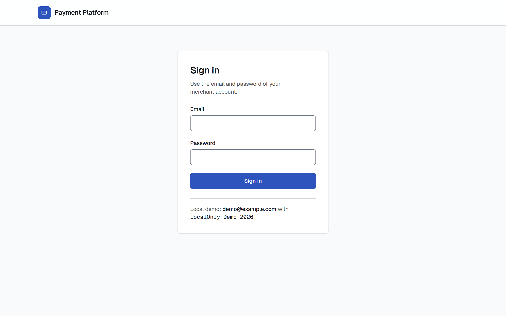

Sign in with `demo@example.com` and `LocalOnly_Demo_2026!` (the page shows them, because compose turns the hint on).
A wrong password says so and keeps the email; the sixth attempt for one email within five minutes is refused with how long to wait.
The 21st attempt from one address within a minute is refused too, whatever the emails: the page comes through a Caddy edge that writes the address it saw, and the dashboard passes that on to the API under a key only the two share, so a browser cannot dodge the limit by sending its own `X-Forwarded-For` ([ADR 010](decisions/010-client-address-from-the-dashboard.md)).
The dashboard's server made the call and keeps the token in an `HttpOnly` cookie: in the browser's developer tools, `document.cookie` does not show it, and no request from the page goes to the API.

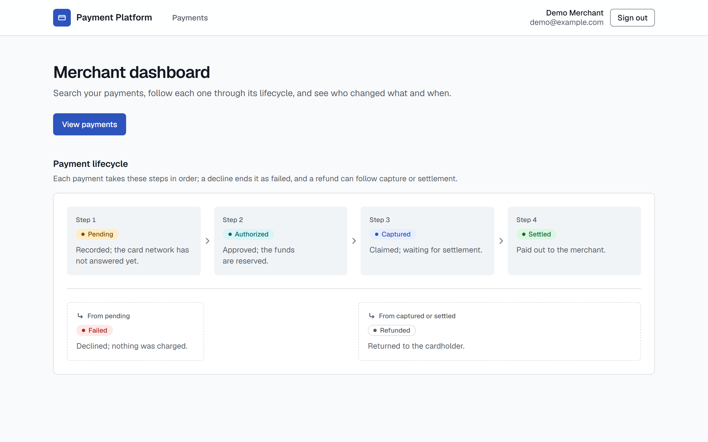

- The header names the merchant and offers **Sign out**; the browser never talks to the API and never sees its address or a token ([ADR 004](decisions/004-authentication-with-short-lived-jwts.md)).
- A merchant is told nothing about the platform's internals: when the API is not ready, the home page says only **Payments are delayed** ([ADR 011](decisions/011-platform-staff-as-their-own-identity.md)).
- **Payment lifecycle** draws the four steps (`Pending`, `Authorized`, `Captured`, `Settled`) as a flow, with each terminal branch (`Failed`, `Refunded`) under the step it leaves.
  It mirrors `PaymentLifecycle` in the domain project, where every one of the 36 status pairs is tested.
- Switch the operating system between light and dark, or narrow the window to a phone's width: the design tokens follow, and a script checks their contrast in CI, including that no status pill reads louder than another.

Now the platform's side. Open <http://localhost:3080/operator>: it has its own sign-in, for staff, and a merchant's session opens nothing there.
Sign in with `operator@example.com` and `LocalOnly_Operator_2026!`.

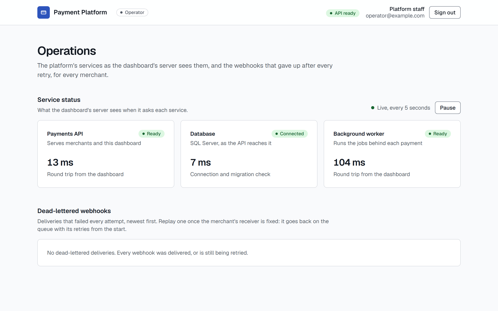

- The header marks the area **Operator**, names the staff user, and shows the API's readiness, **API ready**, as the dashboard's server asked it.
- **Service status** has a tile for the payments API, its database as the API reports it, and the background worker, each with its readiness and a measured time: the round trip from the dashboard's server, or the API's own connection and migration check.
  It asks again every 5 seconds while the tab is visible; **Pause** stops it, because content that updates itself must be stoppable (WCAG 2.2.2).
- **Dead-lettered webhooks** lists every merchant's deliveries that used up their attempts, each with **Replay** (step 5 shows how to make one at once).
- The staff session is a cookie of its own, `pp_staff_session`, sent on `/operator` only; a staff session opens no merchant page either.

- Every response carries a Content-Security-Policy with a nonce made for that request, and only scripts with it run: in the developer tools, each `<script>` has a `nonce` that changes on every reload ([ADR 009](decisions/009-strict-csp-with-per-request-rendering.md)).

Select **View payments** (or **Payments** in the header): the 280 sample payments, newest first, 25 to a page, each amount in its currency's own form (`£44.00`, `¥76,000`, `A$1,012.07`).

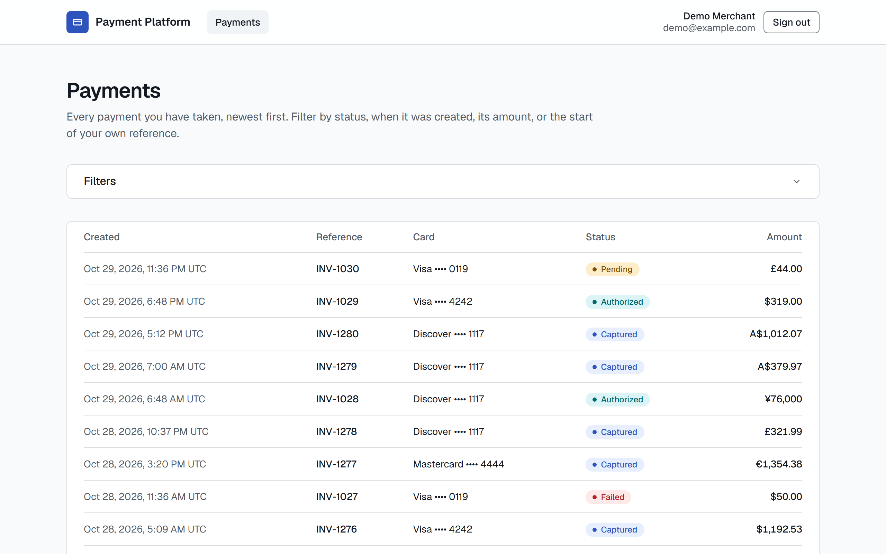

- Open **Filters**, tick **Failed** and **Refunded**, choose **USD**, and apply: the address becomes `/payments?status=failed&status=refunded&currency=USD`, so the view is a link, and the panel says **3 active**.
- An amount filter needs a currency (JPY has no minor unit), so **Amount from** without one is marked and nothing is asked of the API until it is fixed.
- **Older payments** follows the API's cursor and keeps every filter; a reference prefix that matches nothing says so, with a way to clear it.
- At phone width the rows become cards and the filters stay folded until opened.

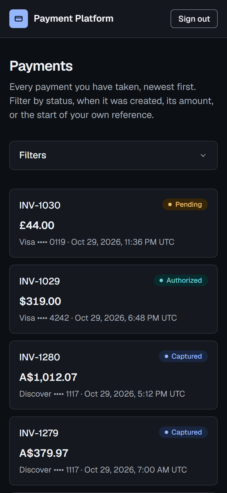

Open a payment from its row: under **Filters**, type `INV-1004` in **Reference**, apply, and select the row.
Its page shows the amount, the status and what it means, the card (brand, last four, expiry), and the authorization reference, then its history, oldest first.

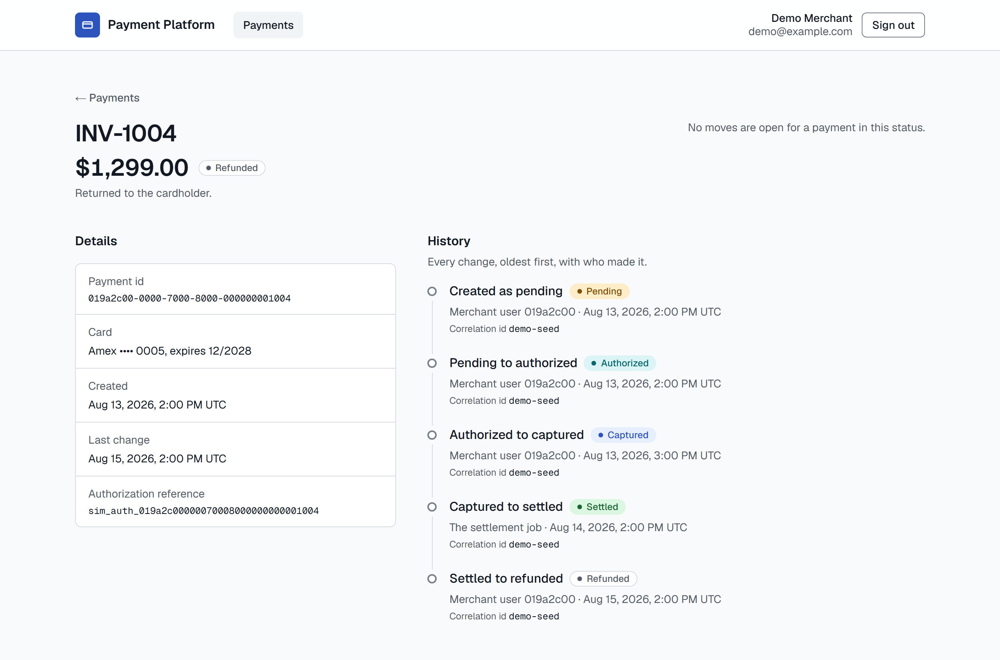

- Each change names its two statuses, who made it (a merchant user, or the `settlement` job by name), when in UTC, and its correlation id, the value to search for in the Aspire logs.
- Open `INV-1025` the same way: it is authorized, so the page offers **Capture €142.00**.
  Capture it, and the page says so and shows the new step; **Refund…** then asks once more before **Refund €142.00** sends it back.
  Each move sends its own `Idempotency-Key`, so a form sent twice moves the money once ([ADR 007](decisions/007-idempotency-keys.md)), and the receiver at `http://localhost:8090/events` gets the signed `payment.captured` and `payment.refunded` webhooks a moment later.
- A refusal from the API is said in words and changes nothing.
  Open an authorized payment in two tabs and capture it in one: **Capture** in the other reads "This payment can no longer be captured: it is not authorized any more."
  A card network that does not answer is "try again in 5 seconds", from the API's `Retry-After`.
- An id that is not one of the merchant's, another merchant's included, is **Payment not found**, the same answer either way.

**The point:** the dashboard is accessible and responsive, shows the running system honestly, and keeps the session out of reach of script in the browser.

## 3. Errors are a contract

```sh
curl -i -H "X-Correlation-Id: demo-1" http://localhost:5080/api/v1/payments/123
```

The answer is `404` with `Content-Type: application/problem+json`, an `X-Correlation-Id: demo-1` header, the security headers (`nosniff`, `DENY`, a `default-src 'none'` policy, `no-referrer`, `no-store`), and a body like:

```json
{
  "type": "https://tools.ietf.org/html/rfc9110#section-15.5.5",
  "title": "Not Found",
  "status": 404,
  "detail": "no resource matches this path",
  "trace_id": "d06d3edee90c34ec64eaab0840c76ce9",
  "code": "not_found",
  "correlation_id": "demo-1"
}
```

Then a method the route does not allow:

```sh
curl -i -X DELETE http://localhost:5080/health/ready
```

That is `405` with `Allow: GET, HEAD`, in the same shape.

**The point:** every error, including the framework's own, is RFC 9457 problem details with a stable `code` a client can switch on, and carries the ids that find it again ([ADR 006](decisions/006-errors-as-problem-details.md)).

## 4. Log in as the demo merchant

Compose seeds one merchant and its dashboard user (`Demo:Seed`, refused in Production):

```sh
curl -s -X POST http://localhost:5080/api/v1/auth/login \
  -H "Content-Type: application/json" \
  -d '{"email":"demo@example.com","password":"LocalOnly_Demo_2026!"}'
```

The answer is `{"access_token":"eyJ...","token_type":"Bearer","expires_at":"...","expires_in":1800}`: an HS256 token for 30 minutes, with no refresh.
Send it back as a bearer token:

```sh
curl -s http://localhost:5080/api/v1/me -H "Authorization: Bearer <access_token>"
```

That names the user and the merchant (`Demo Merchant`); the merchant id every later call is scoped to comes from the token, never from the request.
Then the ways it says no:

- No token, or a forged, tampered, or unsigned one: `401` with `code` `unauthorized` and a `WWW-Authenticate: Bearer` challenge; an expired one is `token_expired`, so a client knows to log in again.
- A wrong password and an unknown email: the same `401 invalid_credentials`, after the same hashing work, so neither the answer nor its timing confirms an account.
- A sixth attempt for one email within five minutes: `429 rate_limited` with `Retry-After`.

**The point:** a request is validated by signature, issuer, audience, algorithm, and lifetime on every call, with no session lookup, and a login expires by itself ([ADR 004](decisions/004-authentication-with-short-lived-jwts.md)).

## 5. Take a payment

With the token from step 4 (on Windows PowerShell 5.1, keep `curl.exe` and put the JSON in a file with `-d "@payment.json"`):

```sh
curl -s -i -X POST http://localhost:5080/api/v1/payments \
  -H "Authorization: Bearer <access_token>" -H "Content-Type: application/json" \
  -H "Idempotency-Key: order-1001-attempt-1" -H "X-Correlation-Id: demo-pay" \
  -d '{"amount_minor":2599,"currency":"USD","merchant_reference":"order-1001","card":{"number":"4242 4242 4242 4242","exp_month":12,"exp_year":2030,"cvv":"123"}}'
```

The answer is `201 Created` with a `Location` header and the payment: `"status":"authorized"`, `"card":{"brand":"visa","last4":"4242",...}` with no number and no token, the acquirer's `authorization_reference`, and a `history` of two rows (`null` to `pending`, `pending` to `authorized`), each with the demo user as the actor and `demo-pay` as the correlation id.
`curl` the `Location` with the same token to read it back; a different merchant's token gets `404`, the same answer as an id that does not exist.

Now the retry a timeout would cause: send the exact same command again.
The answer is the same `201`, byte for byte, with the same `Location` and an `Idempotent-Replayed: true` header, and no second payment exists.
Change the amount and keep the key, and it is `422 idempotency_key_reused`; leave the header out, and it is `400 idempotency_key_required`.
Fire the command several times at once and one request does the work while the others get `409 idempotency_request_in_progress`.

The simulated vault accepts only test cards, and each one takes a branch:

| Card number | Outcome |
| --- | --- |
| `4242 4242 4242 4242` (Visa), `5555 5555 5555 4444` (Mastercard), `3782 822463 10005` (Amex, four-digit CVV), `6011 1111 1111 1117` (Discover) | `authorized` |
| `4000 0000 0000 0002` | `failed`, `failure_reason` `card_declined` |
| `4000 0000 0000 9995` | `failed`, `insufficient_funds` |
| `4000 0000 0000 0119` | `pending`: the acquirer does not answer, so the payment stays visible; the worker's reconciliation asks again every minute, and fails it as `acquirer_unreachable` after a day |
| `4000 0000 0000 0127` | `pending` at first: the acquirer answers only once the payment is a minute old, so within about three minutes the worker's reconciliation authorizes it, as the `system` actor `reconciliation`, and the receiver gets its `payment.authorized` |
| Any other valid number, such as `4111 1111 1111 1111` | `422 card_not_accepted`, and nothing is stored |

A mistyped number (`4242 4242 4242 4241`) is `400` with `"errors":{"card.number":["card_number_invalid"]}`.

The demo merchant also starts with 280 sample payments from the last 90 days (thirty named ones and 250 generated from a fixed hash), in every status, each walked through the domain so its history is real (correlation id `demo-seed`).
Their ids are fixed, so these read back the same on every machine:

| Payment | Shows |
| --- | --- |
| `019a2c00-0000-7000-8000-000000001004` (`INV-1004`) | The whole lifecycle: `pending`, `authorized`, `captured`, `settled` by the `system` actor `settlement`, then `refunded` |
| `019a2c00-0000-7000-8000-000000001016` (`INV-1016`) | `captured`, until the worker's first settlement run settles it with the stack's other captured payments, within a minute of the start |
| `019a2c00-0000-7000-8000-000000001025` (`INV-1025`) | `authorized`, ready to capture |
| `019a2c00-0000-7000-8000-000000001006` (`INV-1006`) | `failed` with `card_declined` |
| `019a2c00-0000-7000-8000-000000001023` (`INV-1023`) | `failed` with `acquirer_unreachable`: the acquirer never answered, and the `reconciliation` job gave up a day later |
| `019a2c00-0000-7000-8000-000000001030` (`INV-1030`) | `pending`: the acquirer has not answered yet, and reconciliation asks again every minute until it does, or for a day |

List them, newest first, a page at a time, and filter:

```sh
curl -s "http://localhost:5080/api/v1/payments?limit=5" -H "Authorization: Bearer <access_token>"
curl -s "http://localhost:5080/api/v1/payments?limit=5&cursor=<next_cursor>" -H "Authorization: Bearer <access_token>"
curl -s "http://localhost:5080/api/v1/payments?status=refunded,failed&currency=USD" -H "Authorization: Bearer <access_token>"
```

Each page is `{"data":[...],"next_cursor":"..."}` with summaries (no history); follow `next_cursor` until it is `null` and every one of the 280 payments appears exactly once.
Filters combine: `status` (one or more), `created_from` and `created_to`, `amount_min_minor` and `amount_max_minor`, `currency`, and a `reference` prefix such as `INV-11`; a bad value is a `400` naming the parameter, such as `"errors":{"limit":["invalid_limit"]}`.

Capture the authorized one, then refund it:

```sh
curl -s -X POST http://localhost:5080/api/v1/payments/019a2c00-0000-7000-8000-000000001025/capture \
  -H "Authorization: Bearer <access_token>" -H "Idempotency-Key: capture-1025"
curl -s -X POST http://localhost:5080/api/v1/payments/019a2c00-0000-7000-8000-000000001025/refund \
  -H "Authorization: Bearer <access_token>" -H "Idempotency-Key: refund-1025"
```

Each answers `200` with the payment and one more history row.
Repeat the capture with the same key and it replays (`Idempotent-Replayed: true`); repeat it with a new key and it is `409 payment_not_capturable`, because the lifecycle is the second line of defense.
Capturing `INV-1006` (failed) or `INV-1016` (captured, and settled since) is the same `409`; refunding `INV-1001` (settled) works.
These change the sample data; `docker compose down -v` and a fresh start bring it back.

A captured payment does not stay captured: every minute the worker runs the stored procedure `payments.SettleCapturedPayments`, which settles the payments captured more than a minute before (a day, outside compose) in one set-based batch, with their audit rows and `payment.settled` events in the same transaction.
Capture `INV-1026` (`019a2c00-0000-7000-8000-000000001026`, another authorized one) and leave it; read it a minute or two later and its `history` ends `captured` to `settled` by the `system` actor `settlement`, and the receiver's `/events` has its `payment.settled`.
The worker's log reports each batch by currency, as in `Settled 18 USD payments for 1288192 minor units`.
In the Aspire dashboard, the request's trace shows the insert, the `acquirer authorize` call, and the second save as children of `POST /api/v1/payments`, and step 6 follows it into the worker.

Each status change is also an event for the merchant, sent as a signed webhook.
The demo merchant's endpoint is the stack's own receiver (`scripts/webhook-receiver.mjs`, standing in for a merchant's server), set up by the seed:

```sh
curl -s http://localhost:5080/api/v1/webhook-endpoint -H "Authorization: Bearer <access_token>"
curl -s http://localhost:8090/events
```

The first answers `{"url":"http://webhook-receiver:8080/webhooks","enabled":true,...}` with no secret (it is shown only when it is issued); the second lists what the receiver got, newest first: for the payment above, `"outcome":"verified"` with `"type":"payment.authorized"`, the payment id, `"correlation_id":"demo-pay"`, and the `traceparent` of the request, about a second and a half after the payment was taken.
Each delivery carries `webhook-id`, `webhook-timestamp`, and `webhook-signature` headers in the [Standard Webhooks](https://www.standardwebhooks.com/) form (HMAC-SHA256 over the id, the timestamp, and the raw body), and the receiver checks the signature, refuses a timestamp older than five minutes, and drops an id it has seen.

A receiver that is down gets the delivery again, later each time: take a payment with `"merchant_reference":"webhook-fail-1"`, which the receiver answers with `503`, and `/events` shows a `failing_on_purpose` row about 10, 20, and 40 seconds apart (exponential backoff with full jitter, capped at an hour; after 12 attempts the delivery is dead-lettered for an operator).
The worker's log in the Aspire dashboard says the same: `failed attempt 3: HTTP 503; next attempt at ...`.

The endpoint's URL is the merchant's choice, so `PUT /api/v1/webhook-endpoint` checks it before storing it, and the worker checks every address again when it connects: `{"url":"https://169.254.169.254/latest/meta-data"}` (the cloud metadata service), `https://localhost:5080/...`, and `https://sqlserver/...` (a container on the stack's private network) are each `400` with `"errors":{"url":["webhook_url_not_public"]}`, and `http://` is `webhook_url_not_https`.
Only `webhook-receiver` is let through, by a setting both services refuse outside Development.
A `PUT` with a public `https` URL would point the demo merchant's events away from the receiver; `docker compose down -v` brings the seeded endpoint back, and `POST /api/v1/webhook-endpoint/rotate-secret` would issue a secret the receiver does not know, so its `/events` would show `bad_signature`.

A dead-lettered delivery is for the platform's staff to put back, not the merchant ([ADR 011](decisions/011-platform-staff-as-their-own-identity.md)).
Staff sign in on a route of their own, with the seeded local-only operator login:

```sh
curl -s -X POST http://localhost:5080/api/v1/staff/auth/login -H "Content-Type: application/json"   -d '{"email":"operator@example.com","password":"LocalOnly_Operator_2026!"}'
```

The token has `"role":"staff"` and no merchant id, so `GET /api/v1/payments` with it is `403`, as `GET /api/v1/staff/me` is with the merchant's token.
`GET /api/v1/staff/webhook-deliveries?status=dead_lettered` lists every merchant's dead letters, newest first, with the event, the attempts, the last error, and the endpoint by host only.
The `webhook-fail` delivery above dead-letters only after its 12 attempts, about three hours; to see one at once, mark a delivery as the worker would (`-I`, because the table has filtered indexes):

```sh
docker compose exec sqlserver /opt/mssql-tools18/bin/sqlcmd -C -I -U sa -P 'LocalOnly_Admin_2026!' -d payments -Q "UPDATE TOP (1) payments.WebhookDeliveries SET Status = 'DeadLettered', Attempts = 12, LastError = 'HTTP 503' WHERE Status = 'Delivered'"
```

It then appears on the operator page with **Replay**; or, with the API, `POST /api/v1/staff/webhook-deliveries/{id}/replay` with the staff token answers `{"status":"pending","attempts":0,...}`, the worker delivers it within a second, and the API's log says `Webhook delivery 37 of merchant ... replayed by staff user ...`; a second replay is `409 delivery_not_dead_lettered`.

**The point:** a retried create can never charge twice ([ADR 007](decisions/007-idempotency-keys.md)), and the card number is exchanged for a token on arrival and goes no further; nothing stores, logs, or returns it, and a test proves that for every log line and column ([ADR 008](decisions/008-card-tokenization-at-the-edge.md)).
The payment is saved before the card network is called, so an outage leaves a visible `pending` payment rather than a charge with no record, and every status change writes its audit row in the same transaction.

## 6. Follow the request in the Aspire dashboard

Open `http://localhost:18888/traces/detail/` followed by the `trace_id` from step 3.
The trace shows the `payment-api` span and how long it took; select it for its attributes, among them `correlation.id`, the status code, and the path.

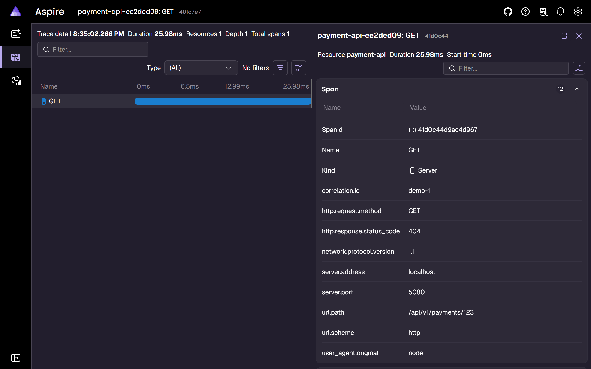

Now the payment from step 5.
Its status change wrote a `payment.authorized` event to the outbox in the same transaction, with the request's `traceparent`; within about a second the worker dispatched it, and within another it delivered it to the receiver.
In **Traces**, the `POST /api/v1/payments` row spans two resources, `payment-api` and `payment-worker`; open it and the one trace holds the API's work, then the worker's `outbox dispatch` (a `Consumer` span) and `webhook deliver` (a `Producer` span, with the attempt number and the receiver's status), whose `HTTP POST 204` child is the call to the receiver.

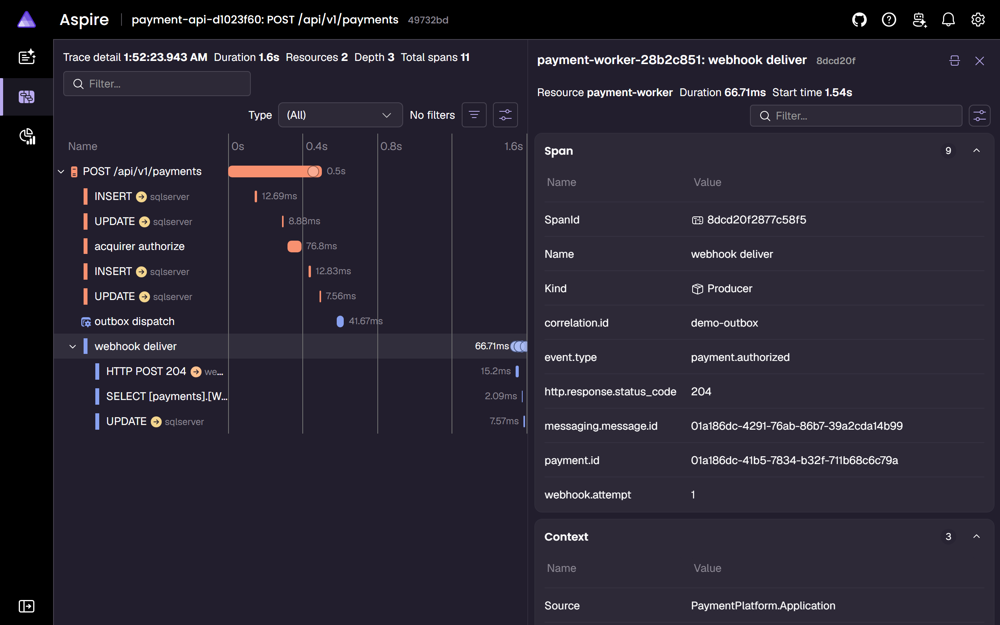

A move made from the dashboard starts one step earlier.
Capture INV-1025 from its page (step 2), and **Traces** gains a `payment-dashboard: POST` row spanning `payment-dashboard`, `payment-api`, and `payment-worker`: the Server Action on the dashboard's server, its call to `POST /api/v1/payments/{id}/capture`, and the worker's dispatch and delivery of `payment.captured`, all one trace.

The worker polls the outbox and the deliveries every second, but those runs are not traces of their own: a trace a second would bury everything else, so only the events it handles are traced, each under the request that caused it ([ADR 005](decisions/005-observability-on-opentelemetry.md)).
To see the queue itself (in Git Bash on Windows, put `MSYS_NO_PATHCONV=1` in front, or it rewrites the container path):

```sh
docker compose exec sqlserver /opt/mssql-tools18/bin/sqlcmd -C -U sa -P 'LocalOnly_Admin_2026!' -d payments -Q "SELECT EventType, CorrelationId, DATEDIFF(millisecond, OccurredAt, DispatchedAt) AS lag_ms FROM payments.OutboxMessages ORDER BY Id DESC"
```

Every status change after creation is a row, dispatched within about a second (`lag_ms`); the 280 sample payments wrote none, because their history is not news.

Then open **Structured logs**: each line is JSON with its trace id and scopes, and the API's startup reports `Database migrated at startup`.
**Metrics** shows `http.server.request.duration`, Kestrel's connections, and the .NET runtime for `payment-api` and `payment-worker`.

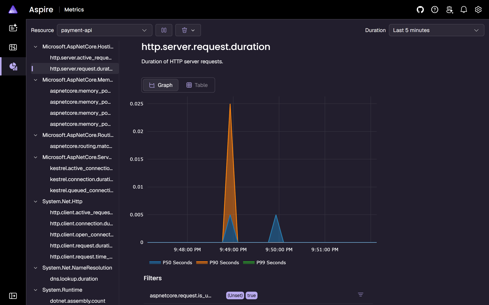

For `payment-worker`, the `PaymentPlatform.Outbox` meter shows the asynchronous workflow: `webhook.delivery.attempts` by outcome (filter on `webhook.outcome` to see the `retried` ones from the `webhook-fail` payment), and gauges for what is waiting and how late it is, `outbox.messages.pending`, `webhook.deliveries.due`, `webhook.deliveries.lag`, `webhook.deliveries.retrying`, `webhook.deliveries.dead_lettered`, `settlement.payments.due`, and `reconciliation.payments.due`, measured every 10 seconds.
`PaymentPlatform.Payments` counts every status change as `payments.transitions`, by the status left and entered (`none` to `pending` is a new payment); the 280 seeded payments do not count, because their history is data, not activity.
Metrics reach the dashboard about once a minute.

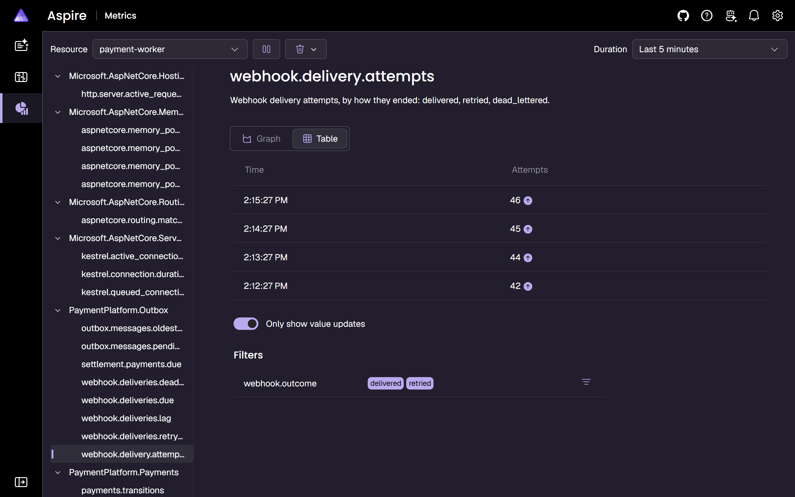

The yellow "Endpoint is unsecured" banner is expected: the dashboard runs without a login because it is local only and bound to 127.0.0.1; a shared environment would use its login token.

**The point:** logs, traces, and metrics share one id from the first request, through OpenTelemetry and OTLP ([ADR 005](decisions/005-observability-on-opentelemetry.md)); in Azure the same export goes to Application Insights.

## 7. Take the database away

Keep the operator area (<http://localhost:3080/operator>) open beside the terminal, and a merchant's home page in another window.

```sh
docker compose stop sqlserver
curl -i http://localhost:5080/health/live
curl -i http://localhost:5080/health/ready
```

- Liveness stays `200`: the process is fine, so nothing restarts it.
- Readiness is `503` with `{"status":"unhealthy",...,"checks":{"database":"unhealthy","self":"healthy"}}`, and it answers within its three-second deadline, outage or not; the body never says why, so it leaks nothing.
- Within five seconds, with no reload, the operator area's badge turns amber, **API not ready**; the API and worker tiles read **Not ready** (both need the database) and the Database tile **Unavailable**.
- A merchant's home page, on its next load, says only **Payments are delayed**, and that nothing already taken is lost.
- The Aspire dashboard's structured logs show the unhealthy check at `Error`, once per probe, each linked to its trace.

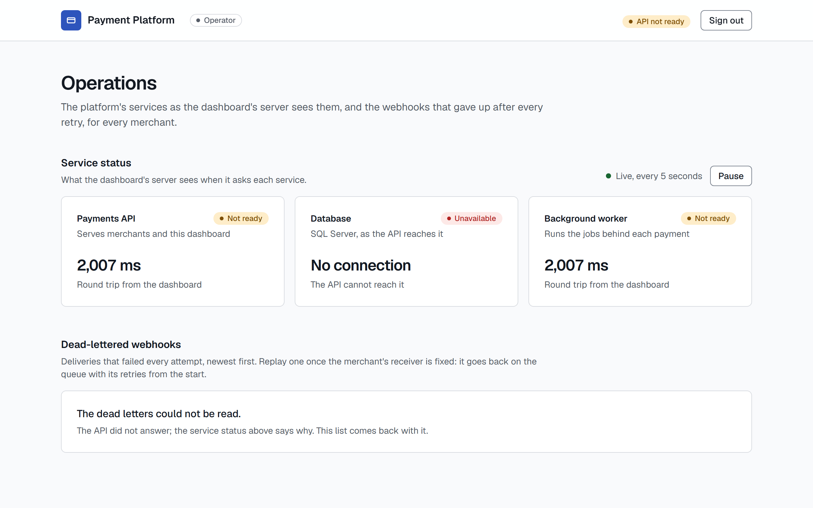

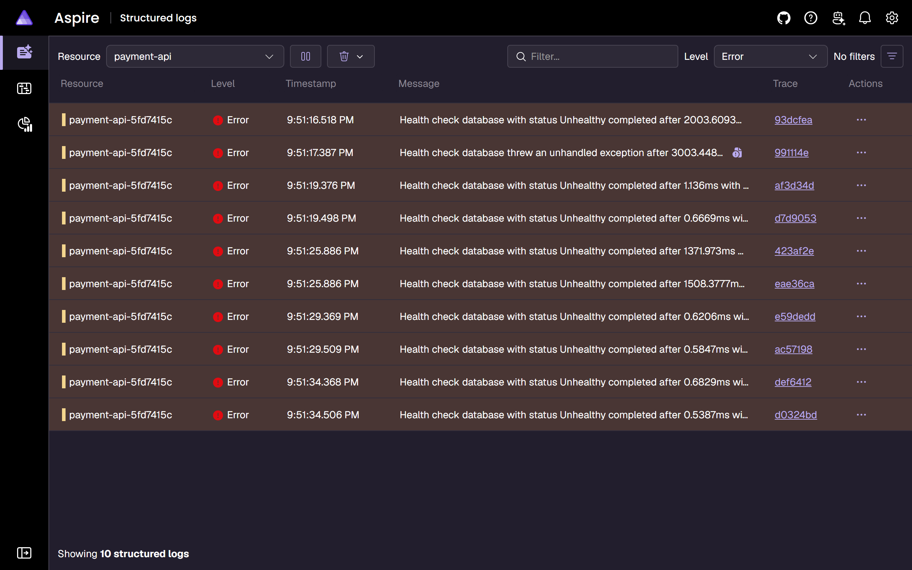

Bring it back:

```sh
docker compose start sqlserver
```

Readiness returns to `200` within about fifteen seconds, and the tiles to **Ready** and **Connected**, with no restart.

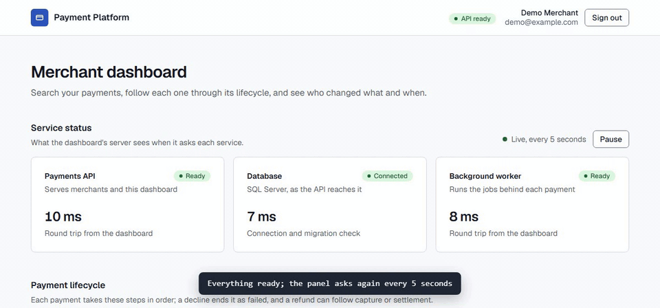

To show the other failure, stop the API instead (`docker compose stop api`): the badge turns red, **API unreachable**, the Database tile reads **Unknown** (only the API can say), and the worker stays **Ready**; `docker compose start api` restores it.

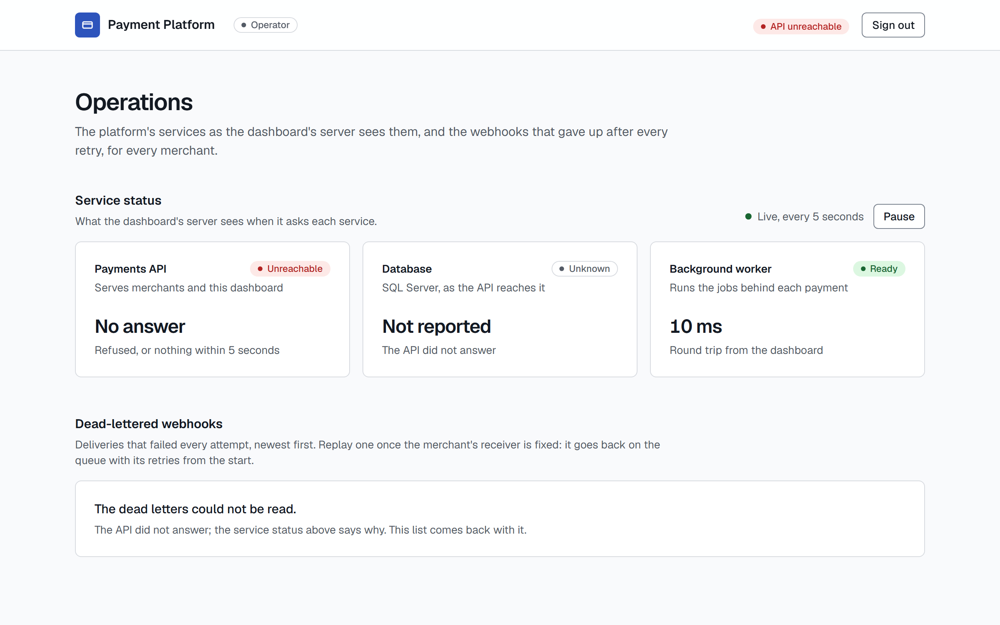

**The point:** a load balancer routes only to instances that can serve, a restart policy only restarts processes that are stuck, and the dashboard tells a merchant which of the two is happening.

## 8. The code and its gates

With the .NET 10 SDK installed ([Prerequisites](../README.md#prerequisites)), from `backend/`:

```sh
dotnet test -c Release
```

584 tests pass in about a minute, including the integration tests, which start their own SQL Server 2025 container.
Worth opening while they run:

- `src/PaymentPlatform.Domain/Payments/PaymentLifecycle.cs`: the transition table and the stable error code for every rejected move.
- `tests/PaymentPlatform.ArchitectureTests`: the project boundaries of [ADR 002](decisions/002-backend-project-boundaries.md), checked in each project file and in the compiled references.
- `tests/PaymentPlatform.IntegrationTests/Health`: the readiness deadline tested against a refused port, a server that never replies, and a connection that blocks its thread.

With the stack running, the golden path walks it the way a merchant would, from `frontend/` (after `npm ci` and `npx playwright install chromium`):

```sh
npm run e2e:stack
```

It signs in, reads INV-1004's history, captures and refunds an authorized payment, and waits for the worker's signed `payment.captured` and `payment.refunded` at the receiver; stop the worker (`docker compose stop worker`) and it fails at that last step.

On GitHub, the CI badge leads to six jobs: backend, frontend, end to end (Playwright at desktop and phone widths), repository checks, Bicep validation, and the one-command stack, which ends with that golden path; CodeQL scans C# and TypeScript.

**The point:** the habits a payment system needs (tests on a real database, enforced boundaries, a pipeline that proves the run instructions) are in place before the first payment.

## 9. Where it goes next

- A replay for dead-lettered deliveries, and alert rules on the queue gauges.
- The operator area in the dashboard: the status panel and the dead letters with their replay, for staff only, and a single "payments are delayed" banner for merchants (T26d).
- The trade-offs behind each choice are in [tradeoffs.md](tradeoffs.md); what changes before real money is in [production.md](production.md).

## Remake the images

The screenshots and the GIF in this guide and the README come from the running stack:

```sh
node scripts/capture-screenshots.mjs
```

It needs `npm ci` and `npx playwright install chromium` in `frontend/`, and FFmpeg for the GIF ([Prerequisites](../README.md#prerequisites)); it stops and starts `sqlserver` and `api` to capture the outages, and leaves both running.
Run it after any change to what a page shows.

## Reset

```sh
docker compose down -v
```

That stops everything and deletes the database volume; the next `docker compose up --build` starts from nothing.
